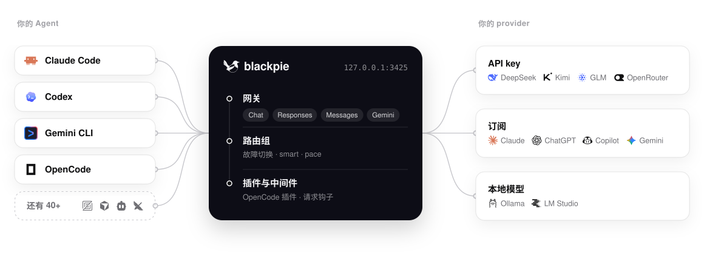

**简体中文** · **[English](README.en.md)**

<div align="center">


<h1 align="center">Blackpie</h3>
<h3 align="center">万物归一</h3>

<b>在各种 Agent 客户端中，使用统一提供的路由模型</b>

    

<p align="center">


</p>

[完整参考(英文)](docs/reference.md) · [文档(Magpie)](https://usemagpie.ai/docs/zh/start) · [插件(Magpie 社区)](https://github.com/magpie-community/plugins)

<picture>
	<source media="(prefers-color-scheme: dark)" srcset="site/public/img/agents-zh-dark.png">
	
</picture>
</div>

## 解决什么痛点？

现在手头的 AI 编程工具（Claude Code、Codex、Cursor、Cline、Zed 等）越来越多，每家的配置文件格式、环境变量、API Key 和 Base URL 都不一样；而且充值的 Pro 订阅通常被死死锁在自家客户端里，没法拿去给别的工具用。

Blackpie 会在本机起一个统一网关，顺便帮你管好所有客户端的配置文件：

* **一处配置，全局切换**：所有 Agent 的模型在同一个面板里选。切换时只精准修改对应客户端配置文件里的模型字段，保留你原本的注释和格式。
* **榨干所有渠道和订阅**：无论是第三方 API Key、中转站、本地 Ollama/LM Studio，还是你本机已登录的 Claude、ChatGPT、GitHub Copilot、Gemini、Grok 订阅，全部统一转成标准接口喂给任意 Agent。
* **自动故障转移与轮询**：同一个服务商挂多个账号，额度耗尽自动切下一个；支持配置路由组（Fallback / 轮询 / 按重置时间调度），对上层 Agent 完全无感。
* **本地敏感信息脱敏（可选）**：开启后，请求离开本机前自动将提示词里的 API Key、密码、邮箱等替换为占位符，等模型返回后再还原回真实值（包括流式输出和 Tool Call 参数）。

如果你只用单一客户端配官方订阅，完全不需要折腾这个；  
但只要你同时在用两三个 Agent、手头攒了一堆 Key 和订阅账号，它会省掉大量改配置的时间。

支持 Windows、macOS、Linux，也可直接扔进 Docker 或手机 Termux 里跑。

## 快速开始

推荐直接前往 [Releases](https://github.com/hmjz100/blackpie/releases) 下载对应平台的预编译二进制包，或从源码构建、使用 Docker 运行（见下文）。

### 从源码运行
通过 Go 编译安装或使用源码构建：

```sh
go install github.com/hmjz100/blackpie@latest

```

## 支持的 Agent

<details>
  <summary>支持的 Agent 客户端</summary>
  <ul>
    <li>Claude Code</li>
    <li>Claude Desktop</li>
    <li>Claude Science</li>
    <li>Codex</li>
    <li>Gemini CLI</li>
    <li>Antigravity CLI</li>
    <li>OpenCode</li>
    <li>OpenChamber</li>
    <li>MiMo Code</li>
    <li>DevEco Code</li>
    <li>Pi</li>
    <li>oh-my-pi</li>
    <li>StepCode</li>
    <li>MothX</li>
    <li>PenguinHarness</li>
    <li>Aside</li>
    <li>OmO</li>
    <li>Prime Agent</li>
    <li>Goose</li>
    <li>Cursor CLI</li>
    <li>Cursor Private Inference</li>
    <li>Zed</li>
    <li>VS Code Chat</li>
    <li>VS Code Insiders</li>
    <li>VSCodium Chat</li>
    <li>Zoo Code</li>
    <li>JetBrains Air</li>
    <li>Copilot (JetBrains)</li>
    <li>Copilot CLI</li>
    <li>Crush</li>
    <li>DeepSeek Harness</li>
    <li>Reasonix Studio</li>
    <li>Command Code</li>
    <li>fx</li>
    <li>Devin</li>
    <li>Hermes Agent</li>
    <li>Mister Morph</li>
    <li>Kimi Code</li>
    <li>jcode</li>
    <li>Qwen Code</li>
    <li>Muse Code</li>
    <li>Empryo</li>
    <li>MiniMax Code</li>
    <li>Droid</li>
    <li>Cline</li>
    <li>Qoder</li>
    <li>Qoder CN</li>
    <li>Grok Build</li>
    <li>Grok App</li>
    <li>ZCode</li>
    <li>WorkBuddy</li>
    <li>WorkBuddy AI</li>
    <li>CodeBuddy</li>
    <li>Pencil</li>
    <li>OpenPencil</li>
    <li>NewMax</li>
    <li>Raycast</li>
    <li>Kiro Crew</li>
    <li>T3 Code</li>
    <li>OpenHanako</li>
    <li>AtomCode</li>
    <li>Snow CLI</li>
    <li>Alma</li>
    <li>Cindy</li>
    <li>Lody</li>
    <li>AionUi</li>
    <li>Ante</li>
    <li>AstrBot</li>
    <li>QwenPaw</li>
    <li>OpenClaw</li>
  </ul>
</details>

不在列表里的工具，只要支持自定义 Base URL，直接指向本地网关也是可以的：

```sh
export OPENAI_BASE_URL=http://127.0.0.1:3425/v1     OPENAI_API_KEY=blackpie
export ANTHROPIC_BASE_URL=http://127.0.0.1:3425     ANTHROPIC_API_KEY=blackpie
export GOOGLE_GEMINI_BASE_URL=http://127.0.0.1:3425 GEMINI_API_KEY=blackpie
```

## 协议转换网关

本地网关内置双向协议转换层，打通了 **OpenAI Chat Completions**、**OpenAI Responses**、**Anthropic Messages** 和 **Google Gemini** 四大接口协议。  
无论上下游协议是否一致，均完整支持流式输出（SSE）、工具调用（Function Calling / MCP）以及思考过程（Reasoning / Thinking）的透传。

<picture>
	<source media="(prefers-color-scheme: dark)" srcset="site/public/img/architecture-zh-dark.svg">
	
</picture>

## 核心特性

### 精细化配置管理与 Profile

点选模型时直接读取各个渠道的实时模型列表（自动从 [models.dev](https://models.dev) 补全上下文长度与定价元信息）。  
修改客户端配置采用原子写入，不会破坏原有文件的排版和注释。  
你可以把整套环境打包成不同的 **Profile**（例如 `work`、`cheap`、`local`），随时一键切换所有客户端的模型组合。

<table>
	<tr>
		<td width="50%">
		<picture>
			<source media="(prefers-color-scheme: dark)" srcset="site/public/img/panel-dark.png">
			
		</picture>
		</td>
		<td width="50%">
		<picture>
			<source media="(prefers-color-scheme: dark)" srcset="site/public/img/picker-dark.png">
			
		</picture>
		</td>
	</tr>
</table>

### 本地隐私脱敏

写代码时，Agent 常会把 `.env`、配置文件或报错日志一股脑塞进上下文发给大模型。在 **设置 → 隐私** 开启脱敏后（默认关闭），所有请求在出网前都会在本地完成拦截与替换。

<picture>
	<source media="(prefers-color-scheme: dark)" srcset="site/public/img/masking-zh-dark.png">
	
</picture>

| 机制 | 说明 |
| --- | --- |
| **正则 + 本地小模型** | 确定性规则匹配 API Key、私钥、Token、邮箱、校验位合法的卡号/证件号；可选下载 1.6GB 本地 CPU 模型识别人名、地址等非结构化敏感词 |
| **无感双向还原** | 发送前替换为 `{{API_KEY_k3v9x2mq}}` 格式占位符，模型回复（含流式片段与工具调用参数）抵达本地后实时还原，确保终端执行的命令能拿到真实密钥 |
| **缓存友好与零落盘** | 同一会话内相同敏感词映射固定的占位符，不破坏 Prompt Cache 与 Thinking 签名；原始明文仅驻留内存，审计日志仅记录类型与前几位字符 |
| **严格熔断** | 开启脱敏后若脱敏引擎异常，网关会直接返回 `503` 阻断请求，绝不降级明文放行 |


> **使用提示**：因为模型看到的是占位符，所以让模型“帮我排查这个 Key 为什么报错”这类任务会失效，此时可将特定值加入「从不脱敏」白名单。

### 全渠道接入与订阅桥接

* **预设丰富**：内置 Anthropic、OpenAI、Gemini、Bedrock、DeepSeek、Kimi、智谱、MiniMax、千问、火山方舟、硅基流动、OpenRouter、Ollama、LM Studio 等数十家预设，支持自定义任意兼容端点及单渠道独立代理。支持一键导入 CC Switch、Claude Code、Codex 和 Alma 现有配置。
* **订阅复用**：通过原生 CLI 桥接或协议适配，把本机已登录的 **Claude**、**ChatGPT / Codex**、**GitHub Copilot**、**Gemini Code Assist**、**Grok** 变成通用 API 供其他工具调用。支持配置「每日预热」，按计划自动触发 Claude/ChatGPT 的 5 小时额度窗口计时。

<picture>
	<source media="(prefers-color-scheme: dark)" srcset="site/public/img/add-zh-dark.png">
	
</picture>


### 路由组与意图分发

把多个渠道或账号编入同一个路由组（如 `group/coding`），支持五种调度策略，且在 Prompt Cache 有效期内默认保持会话粘性（Sticky Session）：

* **`smart`**：优先消耗最快重置的订阅额度，避免过期浪费
* **`order`**：严格按顺序优先级 Fallback
* **`rotate`**：请求级轮询负载均衡
* **`usage`**：优先分配给当前消耗最少的节点
* **`pace`**：按距离重置的剩余时间与剩余周额度比率平滑分配

支持路由组嵌套，也支持挂载一个小模型做**意图路由**——自动识别简单问答丢给便宜模型，遇到写单测或复杂重构再路由给旗舰模型。

<picture>
	<source media="(prefers-color-scheme: dark)" srcset="site/public/img/routing-zh-dark.png">
	
</picture>

<table>
	<tr>
		<td width="50%">
			<picture>
				<source media="(prefers-color-scheme: dark)" srcset="site/public/img/intent-trace-zh-dark.png">
				
			</picture>
		</td>
		<td width="50%">
			<picture>
				<source media="(prefers-color-scheme: dark)" srcset="site/public/img/nested-routing-zh-dark.png">
				
			</picture>
		</td>
	</tr>
</table>

### 插件与网关中间件

兼容 OpenCode 登录插件与 pi 包（基于 Bun 运行时按需拉起），同时支持编写轻量的 JavaScript **网关中间件**，直接 Hook 请求与响应生命周期（类似 New API 的渠道覆写规则）：


```sh
blackpie plugin add opencode-gemini-auth   # npm 上的 OpenCode 插件
blackpie plugin add pi-antigravity         # pi 包，同样的方式
blackpie plugin login google-plugin        # 在 blackpie 里走它自己的登录流程
```

```js
// alias.middleware.js — 通过 blackpie plugin add ./alias.middleware.js 加载
export function onRequest(body, ctx) {
	if (body.model === "fast") return { ...body, model: "deepseek/deepseek-chat" };
}
```

内置常用中间件包括 `param-override`（请求参数增删改）、`model-map`（模型名映射）、`system-prompt`（全局/定向注入系统提示词）、`word-guard`（敏感词过滤）以及 `think-tags`（`<think>` 标签与 `reasoning_content` 互转）。

```sh
blackpie plugin add @magpie-community/middleware-model-map
blackpie plugin options model-map '{"mapping": {"fast": "deepseek/deepseek-chat"}}'
```

在「插件 › 发现 › 网关中间件」里可以找到它们。详见[网关中间件](https://usemagpie.ai/docs/zh/plugins#middleware)。

### 观测、局域网共享与多端同步

<picture>
	<source media="(prefers-color-scheme: dark)" srcset="site/public/img/usage-zh-dark.png">
	
</picture>

* **全链路账单与上下文分析**：按模型官方费率或自定义价格核算 Token 与缓存命中成本，支持查看每次请求的上下文占比明细，支持 OTLP 指标导出。
* **团队/多设备共享**：可开启局域网网关模式，为不同设备签发带日/周/月预算上限的独立 Key；支持通过 WebDAV（坚果云、Nextcloud 等）或 S3 同步多台电脑的配置。
* **通用工具注入**：统一管理全局 Instructions、MCP Server 和 Skills 并分发给各客户端；内置可降级轮询的联网搜索聚合（Tavily、Brave、Exa、SearXNG、豆包/元宝搜索等）及生图/视频 MCP 工具，让原本不带联网能力的模型也能直接搜网页。

## Docker 部署

提供 `linux/amd64` 与 `linux/arm64` 多架构镜像，适合丢在 NAS 或软路由上当家庭/团队统一网关：

```sh
docker run -d --name blackpie --restart unless-stopped \
	-p 127.0.0.1:3425:3425 -p 127.0.0.1:3430:3430 \
	-e BLACKPIE_WEB_KEY=$(openssl rand -hex 16) \
	-v blackpie-config:/config \
	ghcr.io/hmjz100/blackpie:latest web --addr 0.0.0.0:3430 --no-open
```

## 隐私与遥测说明

你的提示词、密钥和业务数据仅在本地网关与你指定的上游模型商之间传输。  
对于原版内置的匿名统计与第三方图标代理请求，可在 **设置 → 隐私** 中彻底关闭，或直接设置环境变量：
```sh
export DO_NOT_TRACK=1
```


## 贡献与反馈

欢迎提交 Issue 反馈 Bug、兼容问题或功能建议，也欢迎直接提 Pull Request 参与改进。

<a href="https://star-history.com/#hmjz100/blackpie&Date">
	<picture>
		<source media="(prefers-color-scheme: dark)" srcset="https://api.star-history.com/svg?repos=hmjz100/blackpie&type=Date&theme=dark">
		
	</picture>
</a>

## 许可证

[MIT](LICENSE)

基于 [yetone/magpie](https://github.com/yetone/magpie) 与 [lingqiqi5211/moepie](https://github.com/lingqiqi5211/moepie) 修改并维护。